# Detailed Project Plan: Interactive 3D Colombian Portfolio

## Project Overview

You want to create an immersive portfolio website where:
- The 3D model (PortafolioBlend.glb) is the central focus
- All content is accessible through interactions with the 3D elements
- Clicking on elements triggers animations, popups, and interfaces
- Traditional website sections are integrated into the 3D experience
- The design incorporates Colombian cultural elements

## Technical Stack

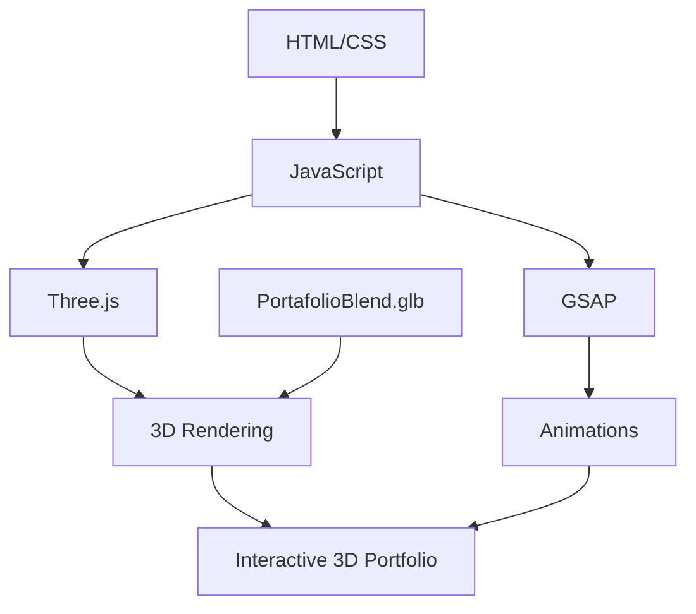

- **Three.js**: For loading and rendering your 3D model
- **GSAP**: For smooth animations and scroll-triggered effects
- **HTML/CSS/JavaScript**: For the base structure and styling

## Project Architecture

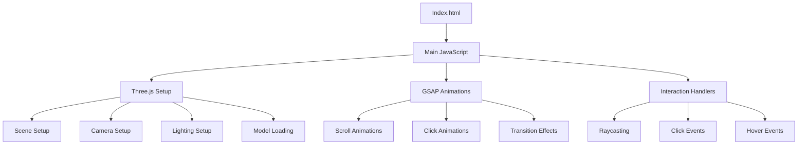

## Implementation Plan

### 1. Project Setup and Structure

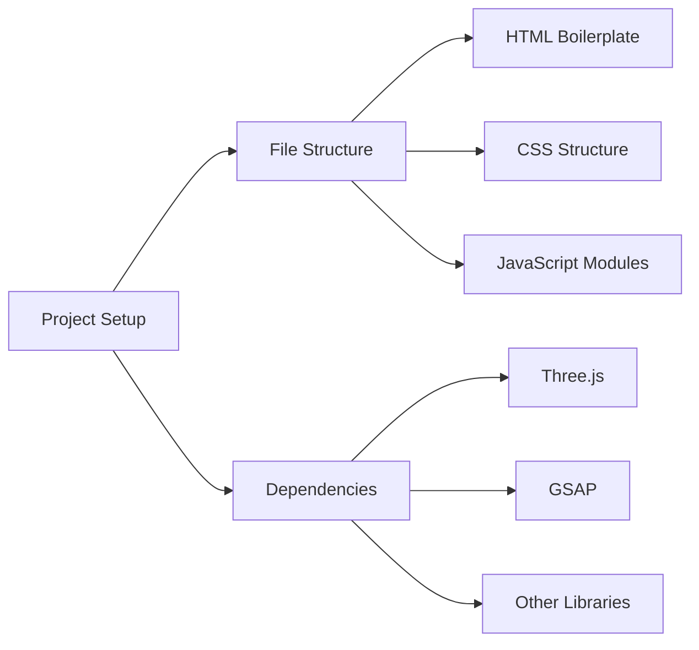

- Create basic project structure
- Set up HTML, CSS, and JavaScript files
- Install necessary dependencies
- Configure build tools if needed

### 2. 3D Environment Setup

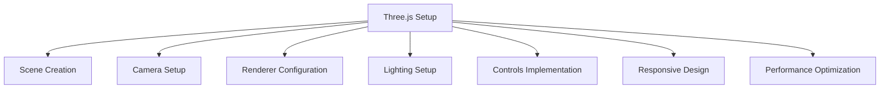

- Initialize Three.js scene, camera, and renderer
- Set up appropriate lighting for your Colombian-themed model
- Implement orbit controls or custom camera movements
- Ensure responsive design for different screen sizes
- Optimize performance for smooth rendering

### 3. Model Integration

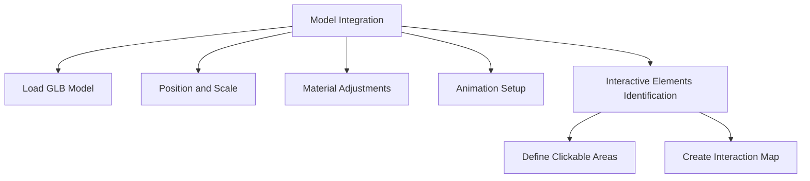

- Load your PortafolioBlend.glb model into the scene
- Position and scale the model appropriately
- Adjust materials and textures if needed
- Set up any built-in animations from the model
- Identify and map interactive elements within the model

### 4. Interaction System

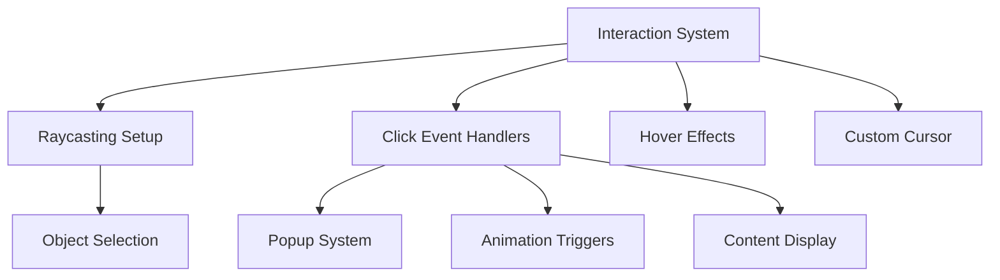

- Implement raycasting for detecting clicks on 3D objects
- Create event handlers for different interactive elements
- Develop a system for displaying popups and interfaces
- Implement hover effects for better user experience
- Create a custom cursor for indicating interactive elements

### 5. Content Integration

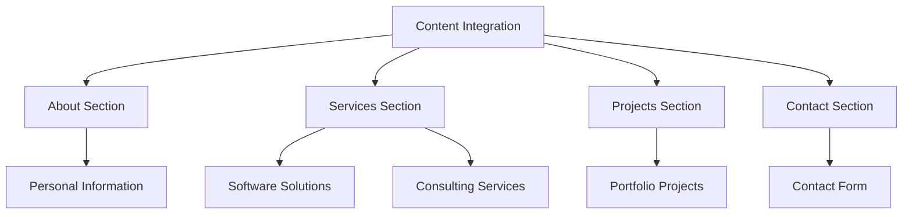

- Design and develop content for each section
- Create HTML templates for popups and interfaces
- Integrate content with the 3D interaction system
- Ensure content is accessible and well-presented

### 6. Animation System

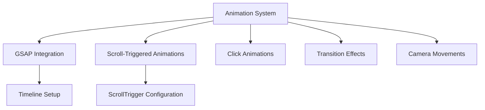

- Set up GSAP for animations
- Implement scroll-triggered animations for model elements
- Create animations for click interactions
- Develop smooth transitions between different states
- Design camera movements for navigating the 3D space

### 7. User Interface

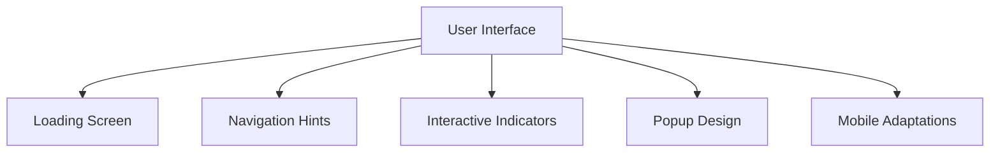

- Design a loading screen for initial model loading
- Create navigation hints to guide users
- Implement indicators for interactive elements
- Design attractive popups and interfaces
- Adapt the experience for mobile devices

### 8. Performance Optimization

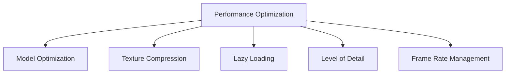

- Optimize the 3D model for web performance
- Compress textures and assets
- Implement lazy loading for content
- Consider level of detail techniques for complex models
- Manage frame rate for smooth experience

### 9. Testing and Deployment

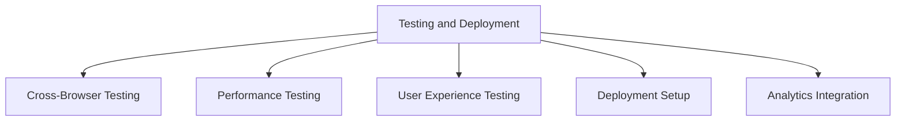

- Test across different browsers and devices
- Evaluate performance and optimize as needed
- Gather feedback on user experience
- Set up deployment pipeline
- Integrate analytics for tracking user interactions

## Technical Considerations

1. **Model Complexity**: The complexity of your 3D model will impact performance. We may need to optimize it for web use.

2. **Interactive Elements**: We'll need to carefully map and implement interactive elements within your 3D model.

3. **Content Management**: Organizing and displaying content through 3D interactions requires thoughtful design.

4. **Performance**: 3D web experiences can be resource-intensive, so optimization will be crucial.

5. **Accessibility**: We should consider alternative ways to access content for users with limited devices or accessibility needs.

6. **Loading Times**: 3D models can be large, so we'll need strategies to manage loading times.

## Implementation Timeline

1. **Week 1**: Project setup, Three.js environment, and model integration
2. **Week 2**: Interaction system and basic animations
3. **Week 3**: Content integration and UI development
4. **Week 4**: Animation refinement and performance optimization
5. **Week 5**: Testing, bug fixing, and deployment