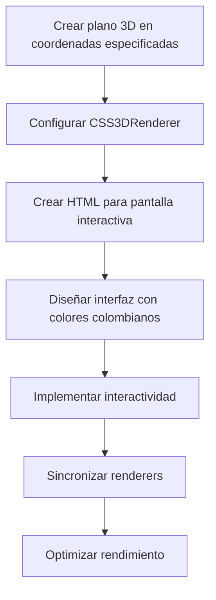

# Plan de Implementación: Pantalla Interactiva en Modelo 3D

## Descripción del Proyecto

Este proyecto consiste en implementar una pantalla interactiva dentro del modelo 3D existente. La pantalla mostrará los servicios profesionales ofrecidos (Software Consulting, FullStack Engineer, Data Engineer, AI Full-Stack Engineer, Prompt Engineer) con un diseño colorido inspirado en la bandera colombiana y colores verdes naturales.

## Requisitos

1. Crear un plano 3D en las coordenadas especificadas:
   - Esquina superior Izquierda: X:-0.54, Y: 6.14, Z: 8.57
   - Esquina superior Derecha: X: 1.70, Y: 6.14, Z: 8.57
   - Esquina inferior Izquierda: X: -0.54, Y: 4.93, Z: 9.17
   - Esquina inferior Derecha: x: 1.70, Y: 4.93, Z: 9.17

2. Implementar una interfaz interactiva con:
   - Diseño colorido con los colores de la bandera colombiana y verdes naturales
   - Listado de servicios profesionales
   - Interactividad para mostrar detalles al hacer clic en cada servicio

3. Integrar la pantalla con el modelo 3D existente sin afectar su rendimiento

## Enfoque Técnico

Utilizaremos **CSS3DRenderer** combinado con el WebGLRenderer existente para lograr una experiencia interactiva completa. Este enfoque nos permite:

1. Incrustar HTML real en la escena 3D
2. Implementar interactividad completa con eventos de clic
3. Crear un diseño rico y colorido con CSS
4. Facilitar transiciones y animaciones fluidas

## Diagrama de la Solución



## Pasos de Implementación

### 1. Añadir CSS3DRenderer a la aplicación

Primero, añadiremos las bibliotecas necesarias para CSS3DRenderer:

```javascript
// Añadir después de las importaciones de Three.js existentes
<script src="https://cdn.jsdelivr.net/npm/three@0.132.0/examples/js/renderers/CSS3DRenderer.js"></script>
```

### 2. Crear el plano 3D y configurar CSS3DRenderer

```javascript
// Variables para CSS3D
let css3dScene, css3dRenderer;
let screenPlane; // Plano invisible para raycasting

function setupInteractiveScreen() {
    // Crear escena CSS3D
    css3dScene = new THREE.Scene();
    
    // Configurar CSS3DRenderer
    css3dRenderer = new THREE.CSS3DRenderer();
    css3dRenderer.setSize(window.innerWidth, window.innerHeight);
    css3dRenderer.domElement.style.position = 'absolute';
    css3dRenderer.domElement.style.top = 0;
    css3dRenderer.domElement.style.pointerEvents = 'none'; // Importante para que los eventos pasen al WebGLRenderer
    document.body.appendChild(css3dRenderer.domElement);
    
    // Crear plano invisible para raycasting en las coordenadas especificadas
    const screenGeometry = createScreenGeometry();
    const screenMaterial = new THREE.MeshBasicMaterial({ 
        opacity: 0,
        transparent: true,
        side: THREE.DoubleSide
    });
    screenPlane = new THREE.Mesh(screenGeometry, screenMaterial);
    scene.add(screenPlane);
    
    // Crear y posicionar el elemento HTML
    createScreenHTML();
}
```

### 3. Crear la geometría del plano basada en las coordenadas proporcionadas

```javascript
function createScreenGeometry() {
    // Coordenadas proporcionadas
    const topLeft = new THREE.Vector3(-0.54, 6.14, 8.57).add(originOffset);
    const topRight = new THREE.Vector3(1.70, 6.14, 8.57).add(originOffset);
    const bottomLeft = new THREE.Vector3(-0.54, 4.93, 9.17).add(originOffset);
    const bottomRight = new THREE.Vector3(1.70, 4.93, 9.17).add(originOffset);
    
    // Crear geometría personalizada
    const geometry = new THREE.BufferGeometry();
    
    // Definir vértices
    const vertices = new Float32Array([
        topLeft.x, topLeft.y, topLeft.z,
        topRight.x, topRight.y, topRight.z,
        bottomLeft.x, bottomLeft.y, bottomLeft.z,
        
        bottomLeft.x, bottomLeft.y, bottomLeft.z,
        topRight.x, topRight.y, topRight.z,
        bottomRight.x, bottomRight.y, bottomRight.z
    ]);
    
    // Definir UVs para mapeo de textura
    const uvs = new Float32Array([
        0, 1,
        1, 1,
        0, 0,
        
        0, 0,
        1, 1,
        1, 0
    ]);
    
    geometry.setAttribute('position', new THREE.BufferAttribute(vertices, 3));
    geometry.setAttribute('uv', new THREE.BufferAttribute(uvs, 2));
    geometry.computeVertexNormals();
    
    return geometry;
}
```

### 4. Crear el HTML para la pantalla interactiva con diseño colombiano

```javascript
function createScreenHTML() {
    // Crear elemento HTML
    const screenElement = document.createElement('div');
    screenElement.className = 'interactive-screen';
    screenElement.style.width = '800px'; // Ancho fijo para el HTML
    screenElement.style.height = '600px'; // Alto proporcional al plano
    
    // Aplicar estilos colombianos
    screenElement.innerHTML = `
        <style>
            .interactive-screen {
                background: linear-gradient(135deg, #003893 0%, #003893 33%, #FCD116 33%, #FCD116 66%, #CE1126 66%, #CE1126 100%);
                color: white;
                font-family: 'Arial', sans-serif;
                padding: 20px;
                border-radius: 10px;
                box-shadow: 0 0 20px rgba(0,0,0,0.5);
                overflow: hidden;
                position: relative;
            }
            
            .screen-header {
                text-align: center;
                margin-bottom: 30px;
                text-shadow: 2px 2px 4px rgba(0,0,0,0.5);
            }
            
            .screen-header h1 {
                font-size: 36px;
                margin: 0;
                padding: 10px;
                background-color: rgba(0,0,0,0.7);
                border-radius: 5px;
            }
            
            .services-container {
                display: flex;
                flex-wrap: wrap;
                justify-content: space-around;
                gap: 20px;
            }
            
            .service-card {
                background-color: rgba(255,255,255,0.9);
                color: #333;
                padding: 15px;
                border-radius: 8px;
                width: 200px;
                cursor: pointer;
                transition: transform 0.3s, box-shadow 0.3s;
                box-shadow: 0 4px 8px rgba(0,0,0,0.2);
                position: relative;
                overflow: hidden;
            }
            
            .service-card:hover {
                transform: translateY(-5px);
                box-shadow: 0 8px 16px rgba(0,0,0,0.3);
            }
            
            .service-card h3 {
                margin-top: 0;
                color: #003893;
                font-size: 18px;
                border-bottom: 2px solid #FCD116;
                padding-bottom: 8px;
            }
            
            .service-card p {
                font-size: 14px;
                margin-bottom: 0;
            }
            
            .service-detail {
                position: absolute;
                top: 0;
                left: 0;
                width: 100%;
                height: 100%;
                background-color: rgba(0,0,0,0.9);
                color: white;
                padding: 20px;
                box-sizing: border-box;
                transform: translateY(100%);
                transition: transform 0.5s;
                z-index: 10;
                overflow-y: auto;
            }
            
            .service-detail h2 {
                color: #FCD116;
                margin-top: 0;
            }
            
            .service-detail .close-btn {
                position: absolute;
                top: 10px;
                right: 10px;
                background: #CE1126;
                color: white;
                border: none;
                border-radius: 50%;
                width: 30px;
                height: 30px;
                cursor: pointer;
                font-weight: bold;
            }
            
            .green-accent {
                position: absolute;
                width: 150px;
                height: 150px;
                background-color: rgba(0,128,0,0.3);
                border-radius: 50%;
                z-index: -1;
            }
        </style>
        
        <div class="screen-header">
            <h1>Servicios Profesionales</h1>
        </div>
        
        <!-- Acentos verdes decorativos -->
        <div class="green-accent" style="top: -50px; right: -50px;"></div>
        <div class="green-accent" style="bottom: -50px; left: -50px;"></div>
        
        <div class="services-container">
            <div class="service-card" data-service="software-consulting">
                <h3>Software Consulting</h3>
                <p>Asesoría experta para optimizar sus proyectos de software</p>
                <div class="service-detail">
                    <button class="close-btn">×</button>
                    <h2>Software Consulting</h2>
                    <p>Ofrezco servicios de consultoría especializada en:</p>
                    <ul>
                        <li>Arquitectura de software</li>
                        <li>Optimización de procesos de desarrollo</li>
                        <li>Evaluación y selección de tecnologías</li>
                        <li>Auditoría de código y seguridad</li>
                        <li>Estrategias de escalabilidad</li>
                    </ul>
                    <p>Con años de experiencia en la industria, puedo ayudarle a tomar las decisiones correctas para el éxito de su proyecto.</p>
                </div>
            </div>
            
            <div class="service-card" data-service="fullstack">
                <h3>FullStack Engineer</h3>
                <p>Desarrollo completo de aplicaciones web y móviles</p>
                <div class="service-detail">
                    <button class="close-btn">×</button>
                    <h2>FullStack Engineer</h2>
                    <p>Desarrollo soluciones completas utilizando:</p>
                    <ul>
                        <li>Frontend: React, Angular, Vue.js</li>
                        <li>Backend: Node.js, Python, Java</li>
                        <li>Bases de datos: SQL y NoSQL</li>
                        <li>DevOps: Docker, Kubernetes, CI/CD</li>
                        <li>Cloud: AWS, Azure, Google Cloud</li>
                    </ul>
                    <p>Puedo llevar su proyecto desde la concepción hasta la implementación con las mejores prácticas de la industria.</p>
                </div>
            </div>
            
            <div class="service-card" data-service="data-engineer">
                <h3>Data Engineer</h3>
                <p>Diseño e implementación de soluciones de datos</p>
                <div class="service-detail">
                    <button class="close-btn">×</button>
                    <h2>Data Engineer</h2>
                    <p>Especializado en:</p>
                    <ul>
                        <li>Diseño de pipelines de datos</li>
                        <li>ETL y procesamiento de datos</li>
                        <li>Data warehousing</li>
                        <li>Big Data (Hadoop, Spark)</li>
                        <li>Integración de fuentes de datos</li>
                    </ul>
                    <p>Transformo sus datos en activos valiosos mediante arquitecturas eficientes y escalables.</p>
                </div>
            </div>
            
            <div class="service-card" data-service="ai-fullstack">
                <h3>AI Full-Stack Engineer</h3>
                <p>Integración de IA en aplicaciones web y móviles</p>
                <div class="service-detail">
                    <button class="close-btn">×</button>
                    <h2>AI Full-Stack Engineer</h2>
                    <p>Combino desarrollo full-stack con IA:</p>
                    <ul>
                        <li>Integración de modelos de ML/DL en aplicaciones</li>
                        <li>Desarrollo de APIs para servicios de IA</li>
                        <li>Implementación de chatbots y asistentes virtuales</li>
                        <li>Procesamiento de lenguaje natural</li>
                        <li>Visión por computadora</li>
                    </ul>
                    <p>Potencio sus aplicaciones con capacidades de inteligencia artificial de vanguardia.</p>
                </div>
            </div>
            
            <div class="service-card" data-service="prompt-engineer">
                <h3>Prompt Engineer</h3>
                <p>Optimización de prompts para modelos de IA generativa</p>
                <div class="service-detail">
                    <button class="close-btn">×</button>
                    <h2>Prompt Engineer</h2>
                    <p>Especialista en:</p>
                    <ul>
                        <li>Diseño de prompts efectivos para LLMs</li>
                        <li>Optimización de resultados de IA generativa</li>
                        <li>Creación de sistemas de instrucciones</li>
                        <li>Evaluación y mejora de respuestas de IA</li>
                        <li>Integración de técnicas avanzadas como RAG</li>
                    </ul>
                    <p>Maximizo el potencial de los modelos de IA generativa para sus necesidades específicas.</p>
                </div>
            </div>
        </div>
    `;
    
    // Añadir interactividad
    const serviceCards = screenElement.querySelectorAll('.service-card');
    serviceCards.forEach(card => {
        card.addEventListener('click', function() {
            const detail = this.querySelector('.service-detail');
            detail.style.transform = 'translateY(0)';
        });
        
        const closeBtn = card.querySelector('.close-btn');
        closeBtn.addEventListener('click', function(e) {
            e.stopPropagation();
            const detail = this.closest('.service-detail');
            detail.style.transform = 'translateY(100%)';
        });
    });
    
    // Crear objeto CSS3D
    const screenObject = new THREE.CSS3DObject(screenElement);
    
    // Calcular posición y rotación basadas en las coordenadas del plano
    positionCSS3DObject(screenObject);
    
    // Añadir a la escena CSS3D
    css3dScene.add(screenObject);
}
```

### 5. Posicionar correctamente el objeto CSS3D

```javascript
function positionCSS3DObject(object) {
    // Calcular el centro del plano
    const topLeft = new THREE.Vector3(-0.54, 6.14, 8.57).add(originOffset);
    const topRight = new THREE.Vector3(1.70, 6.14, 8.57).add(originOffset);
    const bottomLeft = new THREE.Vector3(-0.54, 4.93, 9.17).add(originOffset);
    const bottomRight = new THREE.Vector3(1.70, 4.93, 9.17).add(originOffset);
    
    // Calcular el centro
    const center = new THREE.Vector3()
        .add(topLeft)
        .add(topRight)
        .add(bottomLeft)
        .add(bottomRight)
        .multiplyScalar(0.25);
    
    // Calcular la orientación
    const width = topLeft.distanceTo(topRight);
    const height = topLeft.distanceTo(bottomLeft);
    
    // Vectores para orientación
    const vX = new THREE.Vector3().subVectors(topRight, topLeft).normalize();
    const vY = new THREE.Vector3().subVectors(bottomLeft, topLeft).normalize();
    const vZ = new THREE.Vector3().crossVectors(vX, vY).normalize();
    
    // Crear matriz de rotación
    const matrix = new THREE.Matrix4();
    matrix.makeBasis(vX, vY, vZ);
    
    // Extraer rotación de la matriz
    const rotation = new THREE.Euler().setFromRotationMatrix(matrix);
    
    // Aplicar posición y rotación
    object.position.copy(center);
    object.rotation.copy(rotation);
    
    // Escalar para ajustar al tamaño del plano
    const scale = width / 800; // Ancho del div HTML es 800px
    object.scale.set(scale, scale, scale);
}
```

### 6. Actualizar la función de animación para renderizar ambas escenas

```javascript
function animate() {
    requestAnimationFrame(animate);
    
    // Código existente para animación de cámara...
    
    // Actualizar controles
    controls.update();
    
    // Actualizar coordenadas si están visibles
    if (coordinatesVisible && !cameraAnimation.enabled) {
        updateCoordinatesDisplay();
    }
    
    // Renderizar escena WebGL
    renderer.render(scene, camera);
    
    // Renderizar escena CSS3D con la misma cámara
    if (css3dRenderer) {
        css3dRenderer.render(css3dScene, camera);
    }
}
```

### 7. Implementar detección de clics en el plano 3D

```javascript
function setupRaycasting() {
    const raycaster = new THREE.Raycaster();
    const mouse = new THREE.Vector2();
    
    // Manejar clics en la escena
    window.addEventListener('click', function(event) {
        // Calcular posición normalizada del ratón
        mouse.x = (event.clientX / window.innerWidth) * 2 - 1;
        mouse.y = -(event.clientY / window.innerHeight) * 2 + 1;
        
        // Actualizar raycaster
        raycaster.setFromCamera(mouse, camera);
        
        // Comprobar intersección con el plano
        const intersects = raycaster.intersectObject(screenPlane);
        
        if (intersects.length > 0) {
            // Convertir coordenadas de intersección a coordenadas UV
            const uv = intersects[0].uv;
            
            // Simular clic en el elemento HTML correspondiente
            simulateClickOnHTML(uv.x, uv.y);
        }
    });
}

function simulateClickOnHTML(x, y) {
    // Convertir coordenadas UV (0-1) a coordenadas de píxeles en el elemento HTML
    const screenElement = document.querySelector('.interactive-screen');
    const width = screenElement.offsetWidth;
    const height = screenElement.offsetHeight;
    
    const pixelX = Math.floor(x * width);
    const pixelY = Math.floor((1 - y) * height); // Invertir Y para coordenadas DOM
    
    // Encontrar el elemento en esas coordenadas
    const elementAtPoint = document.elementFromPoint(pixelX, pixelY);
    
    // Simular clic si es un elemento interactivo
    if (elementAtPoint && (elementAtPoint.classList.contains('service-card') || 
                          elementAtPoint.classList.contains('close-btn'))) {
        elementAtPoint.click();
    }
}
```

### 8. Inicializar todo en la función init existente

```javascript
// Añadir a la función init existente
function init() {
    // Código existente...
    
    // Configurar pantalla interactiva
    setupInteractiveScreen();
    setupRaycasting();
    
    // Resto del código existente...
}
```

## Consideraciones Adicionales

1. **Rendimiento**: La combinación de WebGLRenderer y CSS3DRenderer puede afectar el rendimiento, especialmente en dispositivos móviles. Podemos implementar optimizaciones como:
   - Renderizar la escena CSS3D solo cuando sea visible
   - Reducir la complejidad del HTML cuando la cámara está lejos

2. **Compatibilidad**: CSS3DRenderer requiere un navegador moderno con soporte para transformaciones 3D CSS.

3. **Responsividad**: El diseño HTML debe ser responsivo para adaptarse a diferentes tamaños de pantalla.

4. **Integración con el modelo existente**: Asegurarnos de que la pantalla interactiva se integre correctamente con el modelo 3D existente y no cause conflictos.

## Diagrama de Flujo de Interacción

```mermaid
sequenceDiagram
    participant Usuario
    participant Raycaster
    participant Plano3D
    participant CSS3DObject
    participant HTML

    Usuario->>Raycaster: Clic en pantalla
    Raycaster->>Plano3D: Detectar intersección
    Plano3D->>Raycaster: Devolver punto de intersección
    Raycaster->>CSS3DObject: Convertir a coordenadas UV
    CSS3DObject->>HTML: Simular clic en elemento
    HTML->>Usuario: Mostrar detalle del servicio
    Usuario->>HTML: Clic en botón cerrar
    HTML->>Usuario: Ocultar detalle del servicio